<a href="https://www.olittechnologies.co.in"></a>



<a href="https://github.com/vinayakkam/gitpilot"></a>
<a href="https://github.com/ANI-CPU-tech/LatchVerify"></a>
<a href="https://www.olittechnologies.co.in/bot/"></a>
<a href="https://github.com/vinayakkam/Project-Nexus"></a>
<a href="https://github.com/vinayakkam/twilight-desktop"></a>

<a href="https://github.com/vinayakkam?tab=repositories"><b>All repositories →</b></a>

<a href="https://www.olittechnologies.co.in/bot/"></a>

<b>What each game does</b>

 

| Game | Description |
|---|---|
| 🪨 **Rock Paper Scissors** | Play via interactive buttons and earn points |
| 🪙 **Coin Flip** | Guess heads or tails for rewards |
| 🎲 **Dice Roll** | Roll and test your luck |
| 🔢 **Number Guess** | Guess the correct number via modal input |
| 🧮 **Math Quiz** | Solve random math questions for points |
| 🔤 **Word Unscramble** | Unscramble words by difficulty level |
| 🎓 **Space Trivia** | Test your knowledge of space & science |
| 🥢 **Booster Catch** | Interactive SpaceX booster catching simulation |
| 🌌 **Galaxy Explorer** | Procedurally generated galaxy & solar system exploration |


 



 

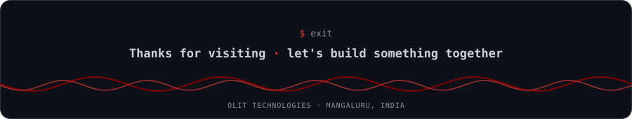
